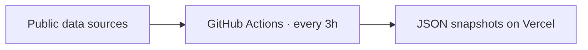
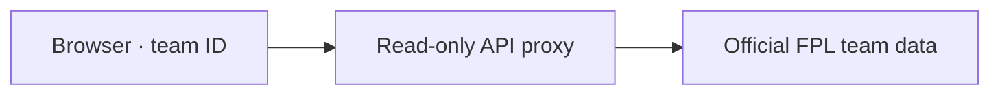

# fpl-dashboard — legacy analytics pipeline

> **Legacy analytics pipeline.** Dashboard utama: [FPL iphoenk](https://fpl-iphoenk.vercel.app/#dashboard). Kode aplikasi aktif: [iphoenk/fpl-iphoenk-dashboard](https://github.com/iphoenk/fpl-iphoenk-dashboard). Proyek Vercel repo ini bernama `fpl-dashboard-legacy`; arsitektur di bawah menjelaskan pipeline repo ini, bukan seluruh aplikasi utama.

Personal FPL dashboard for any team ID: projections, transfer and chip planning,
mini-league analysis and scouting. Hosted on Vercel, rebuilt every three hours
by GitHub Actions. Zero cost: public repo (free Actions minutes), Vercel Hobby,
no paid APIs.

Content follows the shape of [fpl-insights](https://github.com/JonnoMillar/fpl-insights)
(Overview, Planning, Mini-league, Scout, plus a Market tab). That repo has no
licence, so no code was copied: everything here is written from scratch.
[FPLens](https://github.com/abdelmalek-maskri/fplens) (MIT) is used as the
challenger model by reading its published snapshot.

## How it fits together

**Shared data — refreshed in the background**



**Team data — fetched when requested**



The browser combines the shared JSON snapshots with the selected team’s public FPL data. Optional providers and their roles are listed in **Sources** below.

* Everything that is the same for every visitor (all players, fixtures,
  projections) is built in Actions and committed as JSON. Opening the page is
  static files only.
* Everything that depends on a team ID (squad, bank, chips, mini-league) is
  fetched in the browser through `api/fpl.js`, a whitelisted read-only proxy
  with CDN caching. FPL's API cannot be called from a browser directly.
* Transfer, captaincy, chip and wildcard searches run in the browser on the
  projections, so they work for any team without a server.

## Projection authority

`V12` is the intended authority. Its reports are private by design, so this
public build can only use V12 once it publishes a sanitised player-level file;
set the repository variable `V12_PROJECTIONS_URL` to that file and the page
switches automatically. The expected shape is documented in
`pipeline/sources/v12.py`. Until then the dashboard's own model is primary and
FPLens is the challenger. The Market tab shows a weekly backtest of the model.

## Benchmark

Every live build before a deadline logs each model's projection for the coming
gameweek to `public/data/ledger/gwN.json` (dashboard model, FPLens, FPL's own
`ep_next`, and two naive baselines: points per game and FPL form). After the
gameweek finishes, all of them are scored on the same players: rank
correlation (all players, and players who had already played), MAE, top-20
overlap, captain points, and the points each model's own £100m squad would have
scored against the average manager. A retro section re-runs the model from
history alone for past gameweeks, and a head-to-head uses FPLens' own logged
predictions. See the Benchmark tab.

## Phones

The page is built for phones first-class: bottom tab bar, tap tooltips, sticky
name columns in wide tables, full-screen player pages. It can be added to the
home screen (iOS: Share → Add to Home Screen; Android: Install app).

## Sources

| Source | Used for | Join |
|---|---|---|
| FPL API | players, fixtures, live stats per GW, scoring rules | element id |
| Pinnacle guest API | match goal expectations, clean-sheet chances | club name |
| Fantasy Football Scout team news | predicted starters | photo id + club check |
| Rotowire line-ups | predicted starters, injury flags | name within club |
| Opta via Pulselive | big chances, shots, touches | `opta_code` |
| Understat (via V6) | second xG/xA opinion | name within club |
| V6 data plane | Understat, Rotowire and FPL fallback | – |
| FPLens snapshot | challenger projection | element id |
| FPL overall league | proven top-manager ownership | element id |

Every source is optional except FPL itself; a failure shows up in the footer's
source-health table and in the Actions log, never as zeros.

## Local development

```
python -m unittest discover -s tests -t .
python -m pipeline.build --offline --v6 path/to/data/v6/current --out public/data
```

Model parameters live in `pipeline/config.json`. Scoring rules, squad rules and
chip windows are read from FPL's `game_config` at build time.

Personal, non-commercial use.
